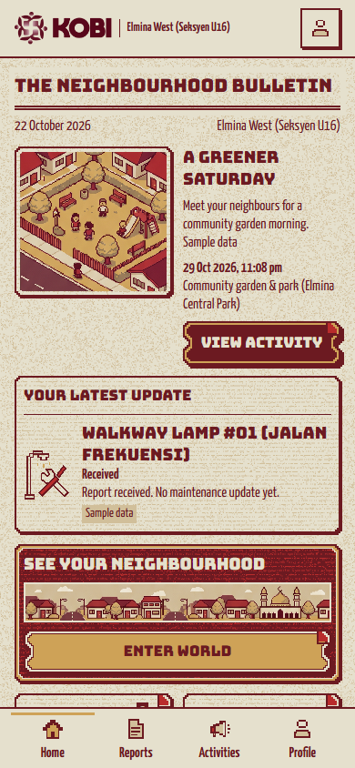
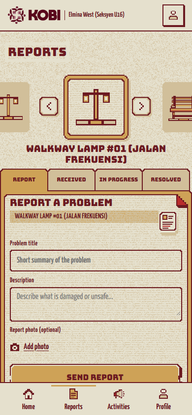
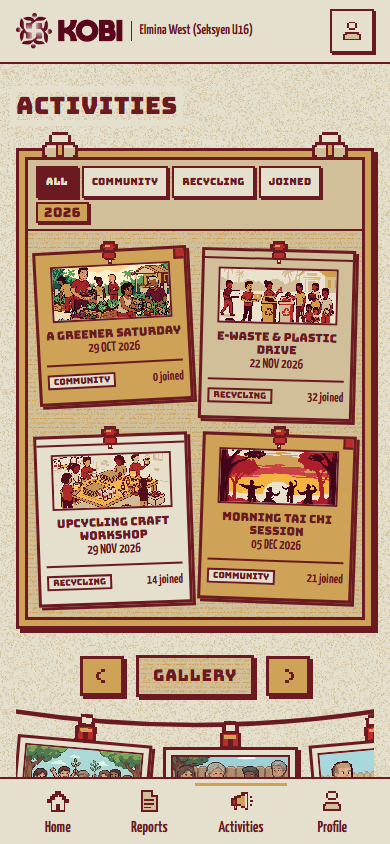
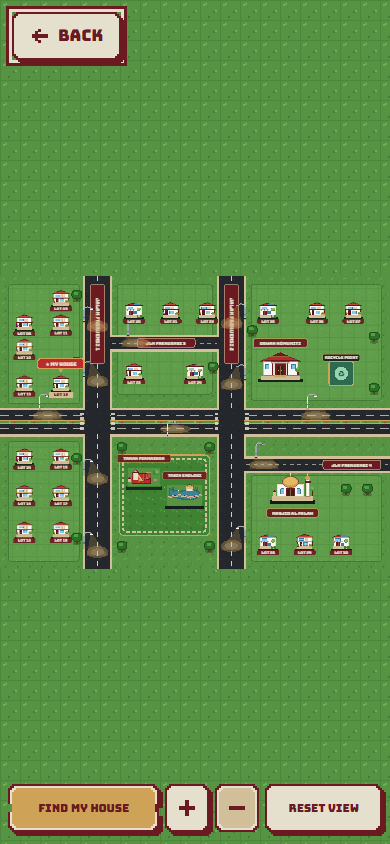

<p align="center">
  
</p>

# KoBi — Komuniti Bijak

**Your neighbourhood. One shared place.**

KoBi is a mobile-first community prototype that connects residents with their neighbourhood. Explore a pixel-art world, report facility problems, follow maintenance updates, and discover community and recycling activities. A separate SDP staff demo supports report handling, activity management and neighbourhood layout editing.

**Current status:** a local frontend demo with sample records saved in your browser. Real authentication, a shared backend and server uploads are not connected. Use invented profile details when trying it.

[What you can try](#what-you-can-try) · [Run locally](#run-locally) · [Resident screenshots](#resident-screenshots) · [Project documents](#project-documents)

## What you can try

| As a resident | As sample SDP staff |
| --- | --- |
| Explore facilities in the pixel neighbourhood. | Add, move and remove components from the demo layout. |
| Create a facility report and follow its action history. | Review reports, update their status and record action notes. |
| Discover community and recycling activities, join or leave. | Create, preview, publish, edit and cancel activities. |
| View your profile and manage browser demo preferences. | Review the same local demo records from the staff view. |

The resident Home bulletin brings together personal reports, maintenance notes and upcoming activities. Reports follow **Received → In progress → Resolved**, with action history available in the demo.

## Run locally

Install Node.js **22.13+ in the 22.x line, or 24+**, and npm. From a terminal:

```sh
git clone https://github.com/nerolynx27/KoBi-Komuniti-Bijak.git
cd KoBi-Komuniti-Bijak
npm ci
npm run dev
```

Open the local address printed by Vite, normally **http://localhost:5173**, and start at **Home** (`/#home`). Keep the terminal running while trying the app. Stop it with **Ctrl+C** when finished.

The initial setup needs an internet connection to install dependencies. There is currently no one-click launcher or hosted app link in this repository.

### A quick resident tour

1. Open **Home** to see the neighbourhood bulletin and sample updates. If a previous session remembered the staff workspace, use the app menu to select the resident view, or open `/#home` directly.
2. Select **Enter World**, explore the facilities and open one to view its details and report options.
3. Create a sample facility report with a description and an optional photo preview. Open **Reports** to explore the report folders and action history.
4. Open **Activities**, explore the community and recycling events, and try joining an activity. Review its details and leave when finished.
5. Visit **Profile** for your demo details and preferences. To restore the sample records, open **Settings → Reset demo** and confirm.

Each browser and local address has its own saved records. Returning to the same address restores those records; photo previews last only for the current page session.

## Resident screenshots

<table>
  <tr>
    <th>Home bulletin</th>
    <th>Facility reports</th>
  </tr>
  <tr>
    <td><a href="docs/readme/resident-home-mobile.png"></a></td>
    <td><a href="docs/readme/resident-reports-mobile.png"></a></td>
  </tr>
  <tr>
    <th>Activity board</th>
    <th>Pixel neighbourhood</th>
  </tr>
  <tr>
    <td><a href="docs/readme/resident-activities-mobile.png"></a></td>
    <td><a href="docs/readme/resident-world-mobile.png"></a></td>
  </tr>
</table>

Actual resident app captures at **390 × 844**, taken on 22 October 2026. All displayed records are samples. Click an image to view it at full size.

## Development and checks

<details>
<summary>Stack, developer setup and automated checks</summary>

The current app uses **React 19, JavaScript/JSX, plain CSS and Vite 8**, with Vitest, ESLint and Playwright for checks. Phaser and Supabase are not installed in the current app; earlier specifications discuss them as later options.

Run these commands from the repository root:

```sh
npm run lint
npm test
npx playwright install chromium
npm run test:e2e
npm run build
npm run test:production
```

Build before running the production checks. The regular browser suite uses port **5177**; production checks use their own configured preview server. For a local production preview, run `npm run build`, then `npm run preview` and use the printed address.

The full browser suite contains a known legacy palette assertion against the old map markup. Historical test counts do not establish a fresh full-suite pass. See the [cleanup verification record](docs/verification/REPOSITORY_CLEANUP.md) for the recorded checks and limitation.

The [developer guide](docs/DEVELOPMENT.md) covers the separate SDP development preview, browser storage, recovery behavior, assets and Graphify. Generated test reports and builds remain outside Git.

</details>

## Project documents

| Document | What it explains |
| --- | --- |
| [Product and design specification](docs/product/product.md) | Current Pixel Stickers design, approved colours, typography and UI requirements. |
| [Technical documentation](docs/product/TECHNICAL_DOCUMENTATION.md) | Product scope, workflows and data contracts; historical plans include future work. |
| [Project report PDF](docs/reports/kobi-report/KoBi-report-technologies.pdf) | Latest retained report, including the technologies section. |
| [Presentation PDF](docs/presentations/presentation.pdf) | Shareable project presentation. |
| [Documentation index](docs/README.md) | Product references, competition guidance, plans and verification records. |
| [Repository layout](docs/REPOSITORY_LAYOUT.md) | Folder ownership, retained sources and generated-file policy. |

## Repository map

```text
src/         App, resident/staff features, shared controls and styles
public/      Runtime artwork, fonts and static assets
art/         Original artwork, asset ledger, licences and provenance
references/  Design references, palette and archived map snapshot
docs/        Product documents, report, presentation and verification
scripts/     Asset preparation, export and verification utilities
tests/       Unit, browser and production checks
videos/      Video project sources and assets
```

Installed dependencies, production builds, local exports, test output and video renders/caches are ignored. Keep original artwork provenance and font notices with their assets.

## Current boundaries

Demo sign-in and resident/staff switching are local controls, not authentication or protected access. Records stay in editable browser storage and are not shared across devices. No report is submitted to a real service. Uploaded-photo previews are temporary; reload retains attachment metadata but cannot restore the image preview.

Production use requires real authentication, server-side permissions, a shared database, durable uploads and privacy controls. Backend integration, deployment and an APK remain outside the current local demo. Phone-size browser checks do not establish physical Android camera, keyboard, TalkBack or hardware Back behavior; those remain unverified.

## Credits and asset notices

KoBi was developed with Codex assistance and Higgsfield-generated artwork. Asset sources and generation records are retained in [art/](art/) and the [asset ledger](art/ASSET_LEDGER.csv), including the activity-board generation record in [art/activity-board-refresh-2026-10-22/](art/activity-board-refresh-2026-10-22/).

The locally hosted **Bungee** and **Yanone Kaffeesatz** fonts retain their [Bungee](public/assets/ui/licenses/bungee-OFL.txt) and [Yanone Kaffeesatz](public/assets/ui/licenses/yanone-kaffeesatz-OFL.txt) SIL Open Font License notices.

No repository-wide code licence has been selected. Third-party assets retain their own terms; project and township references do not imply official endorsement.
