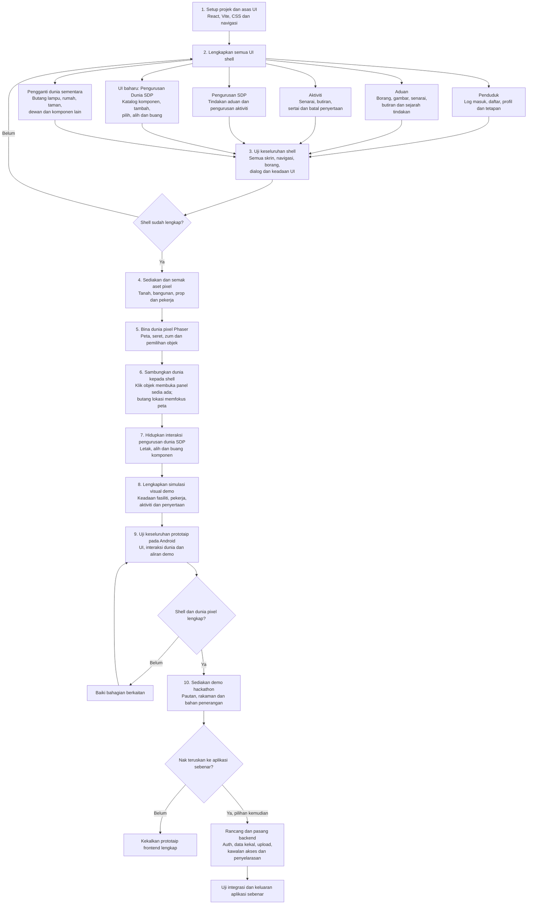
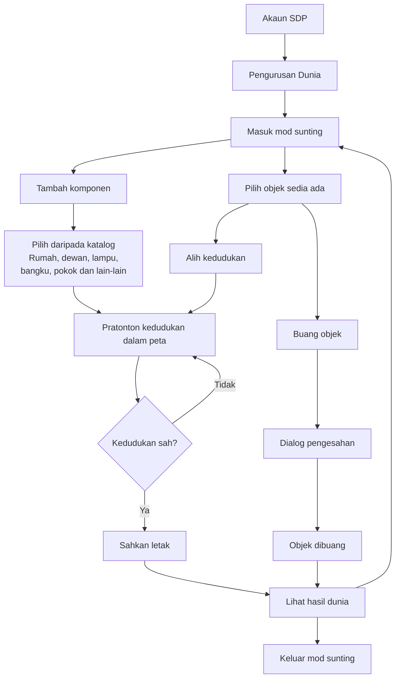

# KoBi — Komuniti Bijak: Pelan Prototaip Hackathon

**22 October 2026 — Bulletin Phase 2:** the user-approved Home dashboard and Home → Enter World → map flow are implemented for review. Existing store/schema and labeled simulation remain. App-wide component rollout (Phase 3) is not authorized. Current results and inherited verification failures are in [Bulletin Phase 2 evidence](../verification/BULLETIN_DASHBOARD_PHASE_2.md).

**Dikemas kini:** 16 Oktober 2026.  
**Status:** Pelan dipersetujui; checklist bukan bukti implementasi.  
**Matlamat utama:** Frontend lengkap untuk demo hackathon: semua UI shell, dunia pixel interaktif dan pengurusan dunia SDP. Backend sangat pilihan dan hanya dipertimbangkan selepas frontend lengkap.

**Urutan dipersetujui:** Shell → uji semua UI → dunia pixel → uji prototaip penuh → demo hackathon → pertimbangkan backend.

**Spesifikasi:** [TECHNICAL_DOCUMENTATION.md](TECHNICAL_DOCUMENTATION.md).  
**Inventori:** [MVP_UI_ASSETS.md](MVP_UI_ASSETS.md).

**Design authority:** [product.md](product.md). Pixel Stickers (set 03) is selected. All app UI, conversation, and new documentation use English. Historical Malay task prose is not a source for final interface labels.

**19 October 2026 specification revision — subsequently implemented:** all UI uses only `#6C1A21`, `#B92C2C`, `#CEA257`, `#D1BF9A` and `#E5E0CD`; future pixel-world artwork is exempt, while UI overlays/editor controls are included. Bungee is the only title/header/wordmark/button font, and Yanone Kaffeesatz is the body/supporting/form-text font throughout the project, including future world text. Existing completion ticks and verification results refer to the earlier palette/fonts. The initial revision did not authorize implementation. Subsequent requests on the same day authorized font replacement and colour-plan execution. Both are now implemented; see [current verification](../verification/UI_COLOUR_MIGRATION.md).

### Palette and typography migration status

- [x] Record the approved five-colour palette and two-font rule across current documentation.
- [x] Subsequent font-replacement request: acquire official font files/licenses, verify family/weight/glyph metadata, record source revision/SHA-256, and remove active old font files/licenses.
- [x] Apply Bungee/Yanone Kaffeesatz roles, font preloads and asset metadata while retaining the existing colour palette. Verify font loading, four responsive sizes, 200% text, fallback/reduced-motion behavior, and the production build: 10 targeted browser checks and 3 production checks passed, plus lint and asset/hash checks. Fresh captures: `artifacts/font-migration/captures/`.
- [x] Migrate semantic colour tokens and text roles/shared styles, retaining the already updated font preloads/asset metadata, Pixel Stickers geometry and existing behavior.
- [x] Verify the new colour pairs, font wrapping/readability, responsive layouts, focus/error/modal/editor states and browser workflows: 20 targeted browser checks, 3 production checks, 137 unit tests, lint, assets and fresh build passed. Review 17 route captures plus component/state captures; physical Android remains unobserved.

Pelan berasaskan hasil, tanpa tarikh akhir atau anggaran tempoh setiap bahagian. Laksanakan satu hasil yang boleh disahkan pada satu masa. Penyediaan dokumen ini tidak mengarahkan pembinaan seluruh aplikasi, generasi berbayar atau deploy secara automatik.

## Kekangan dan maksud siap

- Mobile web Chrome Android dahulu; JavaScript/JSX, React, CSS biasa, Vite dan Phaser **3.90.0**. Dunia pixel art 2D pandangan atas bersudut, bukan 3D.
- Semak versi dan keserasian dependency ketika setup; jangan menggunakan major Phaser lain daripada template tanpa penilaian.
- Shell bermaksud semua skrin dan interaksi UI lengkap, termasuk profil, tetapan, aduan, aktiviti dan skrin SDP. Ia boleh diuji sebelum aset pixel tersedia.
- Ruang peta sementara menggunakan butang lampu, rumah, taman, dewan, bangku dan kitar semula. Butang membuka panel/aliran yang sama dengan sprite kemudian. Rumah tidak memperoleh feature penduduk baharu secara automatik.
- UI-01 hingga UI-17 dikekalkan; UI-18 hingga UI-20 meliputi pengurusan dunia SDP, katalog dan penyuntingan objek.
- Prototaip menggunakan data contoh dan simulasi akaun Penduduk/SDP yang dilabelkan. Simulasi ini bukan pengesahan identiti atau kawalan akses sebenar.
- Data demo dan perubahan dunia disimpan dalam browser dengan versi format dan Reset Demo. Simpanan ini setempat pada browser/peranti, bukan perkongsian data antara pengguna.
- Jangan simpan kata laluan dalam browser. Gambar boleh dipratonton secara setempat; penyimpanan gambar merentas reload bukan syarat prototaip. Gambar contoh yang dibundel boleh digunakan untuk demo berulang.
- Backend, Auth sebenar, Storage, RLS, RPC dan Realtime tidak menghalang prototaip siap. Jika backend dipilih kemudian, Supabase ialah sumber kebenaran; kegagalan backend tidak boleh diganti kejayaan demo.
- All UI copy, validation and accessibility labels use English; code/data names remain English. Display times in Asia/Kuala_Lumpur. Follow the English action inventory in `docs/product/product.md`.
- Tiada coin, kedai, AI produk, multiplayer, avatar pemain, ekonomi SimCity atau APK. Editor ala SimCity terhad kepada komponen dalam katalog yang disediakan; tiada upload aset atau jenis komponen ciptaan pengguna.

## Flowchart projek

## Flowchart pengurusan dunia SDP

SDP merujuk kepada Sime Darby Property. Mod sunting berada dalam aplikasi yang sama, melalui paparan SDP.

Setiap tindakan sah disimpan ke data demo browser; kegagalan simpan mesti dimaklumkan. Batal peletakan/peralihan membuang pratonton sahaja. Reset Demo memulihkan layout dan rekod contoh selepas pengesahan.

## Fasa A — Lengkapkan shell dahulu

### Visual preparation — before Section 1

Use [product.md](product.md) for the complete component and asset plan. The four 2048×2048 concepts were generated and inspected earlier; model provenance limits remain in the generation record. The user selected set 03. Parts 1–2 now implement the SVG/CSS foundation, fonts and all UI-01–UI-20 local shell workflows. The separate Part 3 device gate remains unchecked.

- [x] Select the final design direction — user chose Pixel Stickers on 16 October 2026.
- [x] Document production recipes, tokens, fonts, all UI-01–UI-20 actions, asset formats, and verification requirements in `docs/product/product.md`.
- [x] Implement shared tokens, fonts, SVG frames/icons, and foundation components in Section 1; verify rendered contrast, crisp geometry, English copy, and phone sizing. See `docs/verification/PART_1.md`.

### Bahagian 1 — Setup projek dan asas UI

**Dependency:** Spesifikasi skop sahaja; tidak memerlukan aset pixel atau Supabase.

- [x] Semak Node/npm serta versi React/Vite yang serasi; scaffold JavaScript/JSX dan lock dependency.
- [x] Sediakan dev, lint, test, test:e2e, build dan preview; ignore rahsia/build/fail sementara.
- [x] Implement the fixed tokens, self-hosted fonts, frame geometry, spacing, safe areas, and 44 px touch minima from `docs/product/product.md`; build the development specimen using the actual shared components.
- [x] Bina komponen bersama: butang pending, medan berlabel, panel bawah, dialog dan feedback.
- [x] Build Map / Reports / Activities / Profile navigation and entry/exit for the SDP demo workspace.
- [x] Sediakan mod demo eksplisit, data contoh, simpanan browser berversi dan Reset Demo dengan pengesahan. Data rosak/kuota penuh memaparkan tindakan pemulihan tanpa reset senyap.
- [x] Jangan memasang atau mewajibkan konfigurasi Supabase untuk menjalankan shell.

**Hasil:** Projek dan navigasi boleh dijalankan tanpa backend atau aset dunia.  
**Semakan:** Jalankan lint/build yang tersedia, navigasi asas dan reload simpanan demo. Catat output sebenar.

**Part 1 evidence (16 October 2026):** Working React/Vite foundation; 8 unit tests, 17 development browser tests and 1 production-preview test passed, with lint/build and four viewport captures. Setup: `README.md`. Results and device-test limits: `docs/verification/PART_1.md`. Part 2 implementation and evidence are now recorded in `docs/verification/PART_2.md`.

### Bahagian 2 — Lengkapkan SEMUA UI shell

**Dependency:** Bahagian 1. **Liputan:** UI-01 hingga UI-20; UI-03 menggunakan pengganti peta sementara.

- [x] Lengkapkan log masuk/daftar, tunjuk kata laluan, validasi dan pemilihan paparan demo Penduduk/SDP berlabel; tiada akaun sebenar dicipta.
- [x] Lengkapkan profil, sunting nama, tetapan, panduan dan log keluar demo.
- [x] Lengkapkan aduan: pilih fasiliti, penerangan, preview/buang gambar, senarai/penapis, butiran, sejarah dan bukti contoh.
- [x] Lengkapkan aktiviti: kategori, butiran, lokasi, jumlah peserta, sertai/batal dan senarai Disertai.
- [x] Lengkapkan operasi SDP: senarai aduan, catatan, peralihan status dan bukti selesai dalam data demo.
- [x] Lengkapkan pengurusan aktiviti SDP: senarai, cipta, sunting, draf, terbit, pratonton dan batal.
- [x] Bina ruang sementara dengan butang lampu, rumah, taman, dewan, bangku dan kitar semula; gunakan ID objek stabil. Rumah boleh membuka maklumat asas tanpa menambah fungsi rumah penduduk.
- [x] Butang lokasi kembali ke ruang sementara dan menandakan objek yang dimaksudkan; fasiliti reportable membuka borang yang betul.
- [x] Lengkapkan UI editor SDP: masuk/keluar mod sunting, katalog, pilihan objek, tambah, alih, buang, sahkan dan batal. Gunakan simulasi kedudukan mudah sebelum canvas siap.
- [x] Sediakan keadaan loading, kosong, gagal, pending, berjaya demo, sesi tamat, tiada akses dan input belum disimpan yang boleh diperiksa.
- [x] Data demo dikemas kini secara konsisten antara skrin dalam browser yang sama; tiada butang utama yang mati.

**Hasil:** Semua skrin dan flow boleh dicuba sebelum dunia pixel dibina.  
**Siap apabila:** Inventori UI-01 hingga UI-20 dipenuhi bagi shell; semua simulasi dilabelkan dan tiada operasi dipersembahkan sebagai penghantaran sebenar kepada SDP.

**Part 2 evidence (16 October 2026):** All 14 tasks and UI-01–UI-20 complete for the local browser demo. Lint clean, 136 unit tests, 63 browser tests, fresh build and 1 production smoke test passed. Actual captures inspected at four required sizes, short landscape and 200% text. See [verification](../verification/PART_2.md). Physical Android/TalkBack and the wider Part 3 gate remain unverified and unchecked.

### Bahagian 3 — Uji dan sahkan shell lengkap

**Dependency:** Bahagian 2. Ini pintu semakan sebelum produksi dunia pixel.

- [x] Run all account, profile/settings, report, activity, SDP and temporary editor flows in desktop Chromium and phone-size/touch emulation.
- [x] Verify both demo views, Back/Close, confirmations, retained failed-save input and repeated activation in the browser suites.
- [ ] Semak 360×800, 390×844 dan Chrome Android sebenar: keyboard, scroll, safe-area dan teks panjang.
- [x] Verify real local empty/error/reload/save/reset states and explicitly labeled simulations; no real backend/session service is claimed.
- [x] Record fresh captures, results and issues; repair confirmed desktop shell defects and rerun checks. The original physical gate remains separate.

**Part 3 execution evidence — 18 October 2026:** Desktop shell verification complete; physical Android gate incomplete. The user explicitly instructed phone-size inspection instead of physical-phone testing, so A01–A08 are Not applicable to the revised execution scope and physically unobserved. The unchecked physical item above is retained as the original acceptance boundary, not a request for phone access. Lint, 137 units, 92 browser tests, assets, fresh build, 3 production tests and 24 selected repetitions Passed; 115 fresh captures reviewed; zero open P0/P1 application defects. See [report](../verification/PART_3.md), [matrix](../verification/PART_3_MATRIX.md), [issues](../verification/PART_3_ISSUES.md) and [physical record](../verification/PART_3_ANDROID.md). Part 4 has not started and requires separate authorization.

**Hasil:** Shell lengkap dengan bukti semakan.  
**Siap apabila:** Semua aliran shell boleh dilalui dan tiada isu layout/interaksi utama terbuka. Aset pixel dan backend tidak menjadi syarat bahagian ini.

## Fasa B — Lengkapkan dunia pixel

### Bahagian 4 — Produksi dan semak aset pixel

**Dependency:** Shell lulus Bahagian 3; rujukan gaya dan kebenaran produksi berkaitan tersedia.

- [ ] Tetapkan perspektif atas bersudut, tile 32 px, palet, cahaya dan sampel rumah/lampu/pekerja bersama.
- [ ] Sediakan ledger sumber, prompt, model, terma dan status QA; produksi satu keluarga aset pada satu masa.
- [ ] Lengkapkan tanah/bangunan/prop AS-01 hingga AS-11, pekerja AS-12 hingga AS-14 dan marker AS-15 hingga AS-17.
- [ ] Guna semula ikon/font shell AS-18/AS-19; tambah ikon katalog, alih dan buang yang diperlukan.
- [ ] Semak alpha sebenar, dimensi, pivot, seam tile, nearest-neighbor dan identiti watak setiap frame.
- [ ] Susun walk 128×192 dan repair 128×48; periksa loop awal 6 FPS pada skala telefon.
- [ ] Sediakan fail processed, manifest, katalog komponen dan metadata footprint/hit area yang tepat.
- [ ] Sediakan validator path/key/dimensi/frame; jalankan terhadap aset sebenar dan pastikan fixture tidak sah ditolak.

**Hasil:** AS-01 hingga AS-19 disemak dan siap integrasi, termasuk aset katalog editor.  
**Siap apabila:** Manifest, ukuran, sumber dan semakan visual padan; imej mentah tidak terus dibundel sebagai aset runtime.

### Bahagian 5 — Bina dunia pixel Phaser

**Dependency:** Bahagian 4; shell sedia ada.

- [ ] Gunakan Phaser 3.90.0; layout pilot 32×24 tile, dunia 1024×768 px.
- [ ] Bina satu game instance; loading/error/retry aset dan cleanup mount/unmount/StrictMode.
- [ ] Implementasikan seret, zum tambah/tolak/reset, bounds dan perbezaan tap/drag 8 CSS px.
- [ ] Susun sprite mengikut tapak Y; gunakan hit test koordinat dunia selepas zoom.
- [ ] Sediakan objek ber-ID stabil, spawn pekerja dan laluan waypoint sah untuk fasiliti reportable.
- [ ] Resize mengikut ruang peta tanpa menggandakan canvas; uji kembali dari tab/background.

**Hasil:** Dunia pixel boleh digunakan pada telefon tanpa backend.  
**Siap apabila:** Objek, kamera, pemilihan dan pemuatan aset berfungsi dengan tepat pada Chrome Android.

### Bahagian 6 — Sambungkan dunia kepada shell

**Dependency:** Bahagian 5.

- [ ] Implementasikan kontrak bridge ready, selected, focus, reset, sync dan input enable/disable.
- [ ] Klik sprite membuka panel/form sama seperti butang sementara menggunakan ID yang sama.
- [ ] Lihat di Peta/Lihat Lokasi memfokus objek yang betul, termasuk arahan sebelum scene ready.
- [ ] Marker beberapa aktiviti satu lokasi membuka senarai pilihan.
- [ ] Panel menyekat input peta dan memulihkannya apabila ditutup; kamera tidak reset tanpa arahan.
- [ ] Gantikan pengganti sementara sebagai laluan peta utama; kekalkan pemilih fasiliti alternatif dalam borang.

**Hasil:** Shell dan dunia menjadi satu pengalaman.  
**Siap apabila:** Semua laluan berasaskan lokasi boleh dilalui dua arah tanpa panel atau ID tersalah.

### Bahagian 7 — Hidupkan editor dunia SDP

**Dependency:** Bahagian 6. **Liputan:** UI-18/UI-19/UI-20.

- [ ] Katalog menggunakan aset tersedia: rumah, dewan, lampu, bangku, pokok, taman dan kitar semula; tiada upload aset baharu.
- [ ] Pilih komponen → ghost/pratonton → sahkan letak atau batal; snap ke grid dan semak footprint dalam bounds serta tidak bertindih.
- [ ] Pilih objek → alih dengan pratonton → sahkan/batal; kekalkan ID semasa mengalih.
- [ ] Pilih objek → buang → pengesahan; reset pilihan/panel yang merujuk objek dibuang.
- [ ] Jana objectId unik bagi setiap salinan; hanya komponen relevan mempunyai facilityId. Salinan rumah hiasan tidak menjadi fasiliti aduan secara automatik.
- [ ] Selaraskan posisi hit area, marker, fokus dan laluan/posisi pekerja apabila fasiliti dialih. Tolak kedudukan yang tiada laluan kerja sah apabila diperlukan.
- [ ] Halang buang fasiliti yang masih dirujuk aduan/aktiviti demo; berikan sebab. Reset Demo ialah laluan memulihkan keseluruhan set contoh.
- [ ] Simpan perubahan sah dalam browser; keluar mod sunting membatalkan pratonton tertunda dan memulihkan kawalan kamera biasa.
- [ ] Uji tambah/alih/buang selepas zoom dan reload; semak Reset Demo memulihkan layout dan rekod yang sepadan.

**Hasil:** SDP boleh menyusun komponen dunia seperti demo pembinaan bandar yang dipersetujui.  
**Siap apabila:** Tambah, alih, buang, batal, simpan setempat dan reset boleh dibuktikan tanpa objek pendua atau rujukan rosak.

### Bahagian 8 — Lengkapkan simulasi visual demo

**Dependency:** Bahagian 7.

- [ ] Aduan demo menukar keadaan normal → reported; tindakan SDP menjadikan repairing; selesai memulihkan normal hanya jika tiada aduan aktif lain.
- [ ] Seorang pekerja bagi setiap fasiliti aktif; animasi berjalan/membaiki berhenti mengikut status demo, bukan menentukan status.
- [ ] Aktiviti demo muncul pada lokasi; sertai/batal mengemas kini status dan jumlah tanpa pendua.
- [ ] Aktiviti dibatalkan/sudah bermula menyekat join demo; label masa/status dan reduced motion masih jelas.
- [ ] Reload memulihkan data dan dunia; penggunaan satu browser dilabelkan, tanpa dakwaan Realtime antara peranti.

**Hasil:** Senario produk lengkap boleh ditunjukkan melalui shell dan dunia pixel.  
**Siap apabila:** Paparan status, sejarah, marker dan pekerja konsisten dengan data demo setempat.

## Fasa C — Semak prototaip dan sediakan demo hackathon

### Bahagian 9 — QA prototaip penuh pada Android

**Dependency:** Bahagian 8.

- [ ] Semak HC-01 hingga HC-08 dalam dokumentasi teknikal dan UI-01 hingga UI-20.
- [ ] Uji flow aduan → tindakan SDP → bukti → dunia, aktiviti → lokasi → sertai/batal, dan editor → tambah/alih/buang → reload/reset.
- [ ] Uji validasi, ketikan berulang, gambar tidak sah, keadaan gagal simulasi, simpanan browser gagal dan input belum disimpan.
- [ ] Semak mount/unmount, satu canvas/listener, fokus lokasi, tap/drag/zoom dan input panel.
- [ ] Uji telefon sebenar, background/resume, keterbacaan, keyboard dan reduced motion; rekod model/browser serta limit prestasi yang diukur.
- [ ] Jalankan lint, ujian logik penting, E2E, validator aset dan build; perbaiki kegagalan dan simpan bukti sebenar.

**Hasil:** Bukti bahawa frontend lengkap untuk demo.  
**Siap apabila:** Kriteria prototaip lulus. Ujian backend tidak ditanda lulus atau diwajibkan dalam fasa ini.

### Bahagian 10 — Deploy demo, bahan penerangan dan serahan

**Dependency:** Bahagian 9; hosting dan arahan deploy/rakaman yang berkenaan tersedia.

- [ ] Pilih static hosting HTTPS; deploy build disemak tanpa environment Supabase wajib.
- [ ] Uji pautan pada Android: initial load, reload, aset/font, semua flow dan simpanan setempat.
- [ ] Sediakan Reset Demo dan data contoh kemas; aktiviti relatif kepada masa demo, tiada data peribadi sebenar.
- [ ] Sediakan senario lampu → aduan → SDP → pekerja → selesai; komuniti/kitar semula → sertai/batal; SDP → tambah/alih/buang komponen.
- [ ] Terangkan akaun, status, penyertaan dan editor sebagai prototaip setempat. Jangan mendakwa laporan telah dihantar kepada SDP atau akses telah dilindungi backend.
- [ ] Sediakan screenshot, rakaman/video mengikut guideline pertandingan, URL, arahan menjalankan/reset dan isu diketahui. Jangan mereka angka impak.
- [ ] Selaraskan dokumen, lockfile, source, aset/ledger dan bukti QA dengan hasil sebenar.

**Hasil akhir wajib:** Prototaip hackathon frontend lengkap dengan shell, dunia pixel dan editor SDP; demo boleh diulang.  
**Siap apabila:** HC-01 hingga HC-08 lulus, UI/aset wajib tersedia dan bahan demo boleh digunakan. Backend tidak diperlukan untuk menandakan prototaip ini siap.

## Fasa D — Backend sangat pilihan, selepas frontend lengkap

**Pintu keputusan:** Hanya bermula selepas Bahagian 1–10 selesai dan pengguna memilih untuk meneruskan ke aplikasi sebenar. Menyiapkan prototaip tidak mengarahkan fasa ini secara automatik. Kontrak backend dalam dokumentasi teknikal disimpan sebagai rujukan masa hadapan; ia bukan checklist wajib hackathon.

### Pilihan B1 — Rancang penyimpanan dunia dan asas Supabase

- [ ] Semak semula skema lama: ia belum meliputi editor dunia dinamik. Tetapkan penyimpanan layout/katalog/objek, ID fasiliti stabil, versi layout, hak staff dan konflik edit serentak sebelum integrasi.
- [ ] Tentukan peraturan buang/arkib fasiliti yang dirujuk aduan/aktiviti; jangan cascade memadam sejarah. Sahkan layout/laluan pekerja di backend.
- [ ] Sediakan migrations, constraints, indexes, seed dan grants minimum; jangan reset projek yang mempunyai data diperlukan.
- [ ] Sediakan Auth, profil resident lalai, township pelayan, RLS dan Storage private dengan had MIME/5 MB.
- [ ] Staff role ditentukan pentadbiran sah; pengguna hanya boleh menyunting nama, bukan role/township.
- [ ] Uji anonymous/resident/staff melalui token pengguna; tiada service-role key dalam frontend.

**Hasil:** Kontrak dunia dinamik disemak dan backend asas selamat untuk integrasi.

### Pilihan B2 — Sambungkan akaun, aduan dan operasi SDP

- [ ] Auth sebenar: signup, pengesahan e-mel mengikut konfigurasi, login, sesi pulih, profil, logout dan pembersihan data sensitif.
- [ ] Tukar service demo kepada Supabase secara eksplisit; tiada fallback demo apabila API gagal.
- [ ] Implementasikan create_complaint idempotent; ID sama/payload sama memulangkan rekod asal, payload berlainan ditolak.
- [ ] RPC status staff menguatkuasakan received → in_progress → resolved, catatan, bukti, expectedVersion, locks dan update atomik sejarah/facility_states.
- [ ] Upload/read private mengesahkan pemilik, complaintId, MIME/saiz dan kewujudan objek; signed URL boleh diperbaharui.
- [ ] Kekalkan form apabila gagal. Semak hasil transaksi yang tidak pasti sebelum cleanup orphan; jangan memadam fail yang telah dirujuk.
- [ ] Uji penduduk B tidak boleh membaca aduan/gambar A, resident ditolak RPC staff, double tap, status sama, konflik versi dan bukti tidak sah.

**Hasil:** Akaun dan kitaran aduan sebenar kekal selepas reload dan mematuhi privasi.

### Pilihan B3 — Sambungkan aktiviti dan penyertaan

- [ ] Implementasikan save_activity/cancel_activity dengan staff/township, version, masa UTC/paparan Malaysia dan lokasi sah.
- [ ] Join/leave mengambil identiti auth; satu peserta per pengguna/acara, idempotent dan row lock konsisten dengan save/cancel.
- [ ] Masa pelayan menyekat join acara draft/cancelled/bermula; leave sebelum mula dibenarkan termasuk cancelled.
- [ ] Pembatalan tidak memadam rekod/penyertaan; jumlah/joined state tidak mendedahkan identiti orang lain.
- [ ] Uji direct API permissions, jam telefon diubah, retry, join/leave serentak dan cancellation semasa detail terbuka.

**Hasil:** Hebahan dan penyertaan sah daripada backend; tiada kejayaan berdasarkan state sementara.

### Pilihan B4 — Sambungkan dunia dinamik dan Realtime

- [ ] Implementasikan kontrak editor B1 dengan kawalan akses staff backend, validasi layout dan konflik versi.
- [ ] Snapshot Supabase menjadi sumber kebenaran; demo browser tidak diimport automatik sebagai data sebenar.
- [ ] Subscribe hanya data yang dibenarkan; peta membaca facility_states, bukan butiran aduan orang lain.
- [ ] Refetch selepas reconnect/foreground dan perubahan; cleanup listener/subscription semasa logout/unmount.
- [ ] Uji dua sesi/peranti, beberapa laporan satu fasiliti, perubahan layout serentak dan pekerja selepas reload.

**Hasil:** Dunia dan data dikongsi dengan betul antara pengguna yang dibenarkan.

### Pilihan B5 — QA dan keluaran aplikasi sebenar

- [ ] Semak AC-01 hingga AC-11 serta penerimaan editor backend yang ditetapkan B1.
- [ ] Uji RLS/RPC menggunakan dua penduduk dan staff; privasi gambar, role/township, transaksi, konkurensi dan retry.
- [ ] Jalankan lint, unit, E2E, validator aset dan build; uji Auth redirect, upload, signed URL dan Realtime pada deploy HTTPS Android.
- [ ] Dokumentasikan migrations, environment publishable, akaun ujian sah, URL dan limit; simpan rahsia di luar repository.
- [ ] Hanya dakwa aplikasi sebenar siap selepas bukti integrasi dan keselamatan lulus. Kegagalan fasa pilihan tidak membatalkan status prototaip frontend yang telah disahkan.

## Peraturan kemajuan untuk Codex

- Baca dependency berkaitan; nyatakan hasil sebelum setiap bahagian dan catat bukti selepas semakan.
- Semua checkbox bermula belum selesai; jangan menandakan kod, ujian atau aset siap berdasarkan dokumen.
- Shell mesti lengkap dan diuji sebelum dunia pixel; backend menunggu frontend lengkap dan keputusan pengguna.
- Simulasi demo yang sengaja dilabelkan dibenarkan; backend gagal tidak boleh disembunyikan melalui simulasi.
- Selaraskan keputusan skop pada timeline, dokumentasi teknikal, inventori UI dan arahan projek yang terkesan.
- Tambahan feature, generasi berbayar, deploy dan operasi destructive mengikut arahan pengguna bagi tindakan berkenaan.
