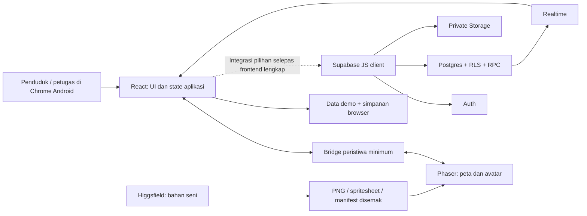

# KoBi — Komuniti Bijak: Dokumentasi Teknikal MVP

**Tarikh:** 16 Oktober 2026  
**Status:** Parts 1–2 implement the local frontend shell. The final pixel world/assets and optional backend remain later phases.  
**Nama projek:** KoBi — Komuniti Bijak (Smart Community).

**Current decision — updated 19 October 2026:** [product.md](product.md) is the authoritative Pixel Stickers design and English UI specification. Use its replacement five-colour UI palette and Bungee/Yanone Kaffeesatz typography plan. The palette exempts future pixel-world artwork; the two-font rule applies to the whole project. The initial revision was documentation only; a subsequent user request authorized replacing/applying the fonts. The later approved colour plan has also been executed: the current build uses Bungee/Yanone Kaffeesatz and the five approved UI colours. All app UI, conversation, and new documentation use English; historical Malay examples below describe behavior, not final interface copy. This update does not change the demo/backend scope.

## 1. Cara Codex menggunakan dokumen ini

1. Baca dokumen ini untuk memahami produk, skop, seni bina dan kontrak data.
2. Baca [MVP_UI_ASSETS.md](MVP_UI_ASSETS.md) bagi skrin, aset, ukuran dan ID.
3. Ikut [PROJECT_TIMELINE.md](PROJECT_TIMELINE.md), satu bahagian yang boleh disahkan pada satu masa.
4. Rujuk [SIMEHACK_GUIDELINE.md](../competition/SIMEHACK_GUIDELINE.md) untuk briefing dan keperluan pertandingan.
5. [3D_WORLD_REFERENCES.md](../archive/3D_WORLD_REFERENCES.md) ialah kajian pendekatan terdahulu, bukan stack atau skop semasa.

Dokumen ini ialah sumber keputusan teknikal semasa. Arahan baharu pengguna mengatasinya; kemas kini dokumen berkaitan apabila keputusan berubah. Jangan menganggap sesuatu sudah siap hanya kerana ia ditulis di sini. Semua checklist pelaksanaan bermula belum selesai.

## 2. Projek ini tentang apa?

Aplikasi kejiranan mobile-first dengan dunia **pixel art 2D, pandangan dari atas bersudut**, untuk penduduk township Sime Darby Property (SDP). Penduduk menggunakan peta untuk memilih fasiliti, membuat aduan dan mengetahui aktiviti. Pasukan SDP menerima laporan, mengemas kini tindakan dan menerbitkan aktiviti masyarakat serta kitar semula.

Dunia 2D ialah antaramuka kepada lokasi dan perkhidmatan. Ia bukan permainan penuh. Avatar pekerja ialah visualisasi status kerja yang dikemas kini petugas, bukan lokasi GPS atau bukti kerja sebenar.

**Masalah yang hendak diuji:** penduduk memerlukan cara yang jelas untuk mengenal pasti fasiliti, menghantar laporan, mengikuti tindakan dan menemui aktiviti setempat. Masalah serta manfaat ini perlu disahkan dengan pengguna; ia belum dianggap dapatan kajian.

**Tema kerja dicadangkan:** PEOPLE — kehidupan digital, keselamatan fasiliti dan hubungan kejiranan. Aktiviti kitar semula memberi manfaat tambahan kepada PLANET. Pengguna belum memuktamadkan pemilihan tema pertandingan; jangan mendakwa kedua-duanya ialah penyertaan rasmi.

## 3. Keputusan dan had prototaip

**Keputusan 16 Oktober 2026:** Sasaran pertama ialah prototaip hackathon: shell lengkap → uji semua UI → dunia pixel lengkap → QA/demo. Backend sangat pilihan selepas frontend lengkap dan keputusan pengguna. Istilah MVP dalam kontrak backend di bawah merujuk kepada cadangan aplikasi sebenar kemudian, bukan syarat siap hackathon.

Semua UI akaun, aduan, aktiviti, profil, tetapan dan SDP dibina dahulu. Peta sementara menggunakan butang objek yang membuka panel sama seperti sprite kemudian. Prototaip menggunakan data contoh, simulasi paparan Penduduk/SDP dan simpanan browser berversi dengan Reset Demo. Ia tidak membuktikan identiti, kawalan akses, upload pelayan atau penyelarasan antara peranti. Jangan menyimpan kata laluan; gambar boleh dipratonton setempat tanpa jaminan kekal selepas reload.

SDP turut mempunyai editor dunia ala SimCity: katalog aset tersedia → pratonton kedudukan → letak, pilih, alih atau buang. Skop ini tidak merangkumi ekonomi permainan, upload aset atau penciptaan jenis komponen baharu.

### 3.1 Keputusan yang telah dipersetujui

- Mobile web pada telefon Android dahulu; APK selepas MVP.
- JavaScript, React, CSS biasa, Phaser dan Vite untuk frontend; Supabase JS bagi backend pilihan kemudian.
- Gaya pixel art seperti rujukan terakhir, bukan dunia 3D atau isometrik berputar.
- Higgsfield digunakan untuk menyediakan bahan visual; Codex mengurus penyediaan fail, kod dan integrasi.
- Aduan dikendalikan oleh petugas SDP bagi fasiliti pilot dalam skop kendalian mereka.
- Aktiviti mempunyai hebahan, butiran, lokasi serta **sertai/batal penyertaan**.
- Pelan pembangunan berasaskan bahagian dan hasil; tiada tarikh atau anggaran masa setiap bahagian.

### 3.2 Skop wajib prototaip hackathon

| Bidang | Hasil wajib |
|---|---|
| Akaun | UI daftar/log masuk, validasi dan simulasi paparan Penduduk/SDP berlabel; tiada Auth sebenar wajib |
| Peta | Satu kejiranan contoh, seret, zum, reset pandangan, pilih fasiliti dan lokasi aktiviti |
| Aduan | Laporan pada fasiliti, penerangan, satu gambar pilihan, senarai sendiri dan sejarah tindakan |
| Operasi SDP | Senarai aduan demo, kemas kini status, catatan dan preview/bukti contoh selesai |
| Pengurusan dunia SDP | Katalog komponen, tambah/letak, pilih, alih, buang dengan pengesahan, simpanan browser dan Reset Demo |
| Dunia hidup | Sprite fasiliti mengikut keadaan dan avatar pekerja ketika status dalam tindakan |
| Aktiviti | Senarai, kategori komuniti/kitar semula, butiran, lokasi, sertai dan batal penyertaan |
| Pengurusan aktiviti | Petugas mencipta, menyunting, menerbitkan dan membatalkan aktiviti; melihat jumlah peserta |
| Profil/tetapan | Nama paparan, e-mel baca sahaja, cara menggunakan peta dan log keluar |
| Demonstrasi | Data berlabel contoh, semua aliran frontend, pautan HTTPS dan bahan rakaman; Supabase tidak wajib |

### 3.3 Di luar skop prototaip

Coin, hadiah, kedai, pembelian pakaian, pengubahsuaian rumah, avatar penduduk yang boleh dikawal, chat, multiplayer, AI dalam produk, push notification, GPS petugas, peta GIS, pembayaran, kapasiti peserta, waitlist, daftar hadir, marketplace, pelbagai bahasa, reset kata laluan kendiri, penggunaan offline penuh dan APK.

Aktiviti kitar semula ialah satu kategori aktiviti. MVP tidak menilai bahan melalui AI, menempah kutipan rumah atau menjejak berat kutipan. Penggunaan AI oleh Codex/Higgsfield dalam pembangunan tidak menjadikan produk ini produk AI.

### 3.4 Andaian backend pilihan untuk aplikasi sebenar

Butiran di bawah terpakai apabila integrasi backend dipilih. Prototaip menggunakan satu township contoh dan paparan demo; privasi sebenar tidak boleh didakwa daripada simulasi UI.

- Satu township pilot; skema menyimpan `township_id` untuk kawalan akses, tanpa UI menukar township.
- Dua peranan: `resident` dan `staff`. Peranan staff diberikan melalui operasi pentadbiran backend yang sah.
- Nama township dan data lokasi ialah contoh sehingga ada data dibenarkan SDP.
- Aduan persendirian: penduduk melihat laporan sendiri; peta berkongsi hanya keadaan fasiliti tanpa identiti pelapor.
- Tiada had peserta untuk MVP. Penyertaan ditutup apabila aktiviti bermula atau dibatalkan.
- All user-facing text uses English, including validation and accessibility labels. Code, filenames, and data fields use English. Use `docs/product/product.md` for the canonical interface wording.

## 4. Pengguna dan kriteria kejayaan

### 4.1 Penerimaan prototaip hackathon — wajib

| ID | Senario yang mesti boleh dibuktikan |
|---|---|
| HC-01 | Semua UI-01 hingga UI-20 dan navigasi lengkap; shell boleh diuji sebelum dunia pixel tersedia |
| HC-02 | Peta pixel boleh diseret/dizum/reset pada Chrome Android; klik objek membuka panel yang betul |
| HC-03 | Aliran aduan demo → tindakan SDP → bukti contoh → sejarah dan keadaan fasiliti konsisten |
| HC-04 | Aktiviti komuniti/kitar semula boleh diterbitkan dalam demo, dilihat pada peta dan disertai/dibatalkan tanpa pendua |
| HC-05 | Editor SDP boleh memilih katalog, meletak, mengalih, membuang atau membatalkan tindakan; kedudukan tidak sah ditolak |
| HC-06 | Rekod demo/layout sah pulih selepas reload pada browser sama; Reset Demo memulihkan set contoh; kegagalan simpan dimaklumkan |
| HC-07 | Semua aliran, keyboard, panel, aset dan interaksi lulus semakan Android serta pautan demo HTTPS |
| HC-08 | Demo/video meliputi aliran produk dan editor; data contoh, akaun simulasi dan had simpanan setempat dilabelkan |

### 4.2 Penerimaan aplikasi sebenar — backend pilihan

AC-01 hingga AC-11 berikut hanya terpakai apabila integrasi backend dipilih. Tambah kriteria layout dinamik, akses staff dan konflik editor sebelum implementasi backend editor; skema lama belum meliputinya.

| ID | Senario yang mesti boleh dibuktikan |
|---|---|
| AC-01 | Penduduk mendaftar/log masuk dan sesi pulih selepas reload |
| AC-02 | Peta boleh digunakan pada Chrome Android portrait; sentuhan memilih fasiliti yang betul |
| AC-03 | Aduan disimpan sekali, muncul dalam senarai sendiri dan diterima petugas SDP |
| AC-04 | Status dan sejarah tindakan kekal selepas reload; penduduk lain tidak boleh membaca butirannya |
| AC-05 | Perubahan kepada `in_progress` menghidupkan visual pekerja; `resolved` menghentikannya |
| AC-06 | Aktiviti komuniti dan kitar semula boleh diterbitkan dan lokasinya dipaparkan dalam peta |
| AC-07 | Sertai/batal penyertaan tersimpan; ketikan berulang tidak menghasilkan peserta berganda |
| AC-08 | Aktiviti dibatalkan atau sudah bermula tidak menerima penyertaan baharu |
| AC-09 | Penduduk tidak boleh menukar status, mencipta aktiviti atau menaikkan peranan melalui API |
| AC-10 | Deploy HTTPS, pemuatan aset, upload dan aliran utama lulus ujian pada telefon sebenar |
| AC-11 | Video boleh menunjukkan masalah → laporan → tindakan SDP → aktiviti → penyertaan secara jujur |

## 5. Stack, versi dan penggunaan alat

| Komponen | Keputusan |
|---|---|
| Bahasa | JavaScript ES modules dan JSX; tiada migrasi TypeScript untuk MVP |
| Development runtime | Node.js 22.13+ in the 22.x line or 24+; verified on Node 24.15.0 / npm 11.12.1 with one `package-lock.json` |
| React | 19.x bersama React DOM pada versi yang sepadan |
| Dunia 2D | **Phaser 3.90.0** sebagai baseline API; jangan naik major tanpa penilaian |
| Build | Vite 8.x dan `@vitejs/plugin-react` yang peer dependency-nya menyokong Vite 8 |
| UI | React + CSS biasa; tiada Tailwind, library komponen besar atau Redux |
| Data | Prototaip: data demo dan simpanan browser; pilihan kemudian: Supabase JS 2.x untuk Auth, Postgres, Storage dan Postgres Changes |
| Logik backend pilihan selepas prototaip | SQL migrations, RLS, triggers dan Postgres RPC; tiada Express/ORM/Edge Functions diperlukan pada baseline |
| Semakan | ESLint, Vitest untuk logik penting, Playwright untuk aliran browser dan semakan visual |
| Hosting | Static hosting HTTPS yang menyokong output `dist`, contohnya Vercel; lokasi akhir dipilih ketika deploy |
| Codex | Membaca spesifikasi, menyediakan projek, menyunting kod/SQL, memproses aset dan menjalankan semakan |
| Higgsfield | Menghasilkan bahan seni rujukan, objek dan frame; bukan backend atau runtime aplikasi |
| Alat penyediaan aset | Skrip Python/Pillow atau editor imej untuk crop, alpha, grid dan pembungkusan; ini preprocessing, bukan engine tambahan |

Versi patch sebenar mesti diselesaikan semasa scaffold, diperiksa keserasiannya, disimpan dalam lockfile dan dicatat di sini. Jadual ini ialah baseline yang dirancang, bukan dependency yang sudah dipasang. Semak pakej yang tidak disokong atau mempunyai isu keselamatan sebelum memasangnya.

**Perhatian template:** `phaserjs/template-react` berguna sebagai rujukan bridge, tetapi `package.json` di branch `main` ketika semakan menggunakan Phaser 4.0.0 walaupun penerangan menyebut Phaser 3. Jangan clone dan anggap API-nya sepadan. Baseline kita ialah projek React/Vite kecil dengan Phaser 3.90.0, mengambil pola integrasi yang diperlukan sahaja.

### 5.1 Arahan pembangunan yang mesti disediakan apabila kod dibina

Parts 1–2 provide these runnable scripts. Exact pinned versions and setup are recorded in `README.md`; actual results are in `docs/verification/PART_1.md` and `docs/verification/PART_2.md`. UI-01–UI-20 now use one v2 browser-demo store. The Phaser world remains a later phase.

```bash
npm ci
npm run dev -- --host 0.0.0.0
npm run lint
npm run test -- --run
npm run test:e2e
npm run build
npm run preview -- --host 0.0.0.0
```

`dev` = Vite; `lint` = ESLint; `test` = Vitest; `test:e2e` = Playwright; `build` = Vite build; `preview` = Vite preview. Preview/dev melalui IP LAN ialah untuk ujian sahaja; hasil akhir menggunakan HTTPS. Ujian yang memerlukan Supabase menggunakan projek ujian dan akaun contoh.

## 6. Seni bina dan peta modul



| Modul | Tanggungjawab | Bergantung pada |
|---|---|---|
| `asset-pipeline` | Bahan seni, manifest dan fail siap guna | — |
| `app-shell` | Layout, navigasi dan komponen UI | — |
| `identity` | UI akaun/profil dan paparan demo; Auth sebenar kemudian | `app-shell` |
| `world-map` | Scene, kamera, pemilihan dan penanda | `asset-pipeline`, `app-shell` |
| `complaints` | UI laporan dan data demo; butang sementara sebelum peta siap | `app-shell` |
| `activities` | UI hebahan/penyertaan dan data demo sebelum peta siap | `app-shell` |
| `staff-tools` | UI petugas bagi kontrak aduan dan aktiviti | `complaints`, `activities` |
| `world-editor` | Katalog/sunting dalam shell; peletakan pixel selepas peta siap | `app-shell`, kemudian `world-map` |
| `release` | QA, deploy dan demo frontend | Modul frontend; tiada dependency backend |

Kod petugas menggunakan service domain yang sama. Semua UI dibina dan diuji dengan mod demo eksplisit sebelum dunia pixel, kemudian backend pilihan. Kontrak Supabase di bawah ialah rujukan integrasi masa hadapan; tiada fallback demo apabila backend sebenar gagal.

### 6.1 Pemilikan state

- React: sesi, profil, tab, panel terbuka, pilihan fasiliti, data Supabase, borang, error dan loading.
- Phaser: kamera, sprite, animasi, koordinat visual dan pointer.
- Mod demo: satu store React/simpanan browser mengurus rekod contoh dan layout merentas shell serta Phaser.
- Mod backend pilihan: Supabase mengurus status, sejarah, aktiviti, penyertaan dan layout sah selepas kontrak editor ditetapkan. Simpanan demo tidak bersaing dengan data sebenar.
- Higgsfield: tiada state aplikasi atau data pengguna runtime.
- Jangan simpan rekod aduan/penyertaan dalam dua store yang bersaing. Local state borang bukan sumber kebenaran selepas operasi berjaya.

### 6.2 Kontrak bridge React–Phaser

| Nama peristiwa | Arah | Payload |
|---|---|---|
| `world:ready` | Phaser → React | `{ mapId }` |
| `facility:selected` | Phaser → React | `{ facilityId }` |
| `activity:selected` | Phaser → React | `{ activityId }` |
| `world:focus` | React → Phaser | `{ facilityId }` |
| `world:reset` | React → Phaser | `{}` |
| `world:sync` | React → Phaser | `{ facilityStates, activityMarkers }` |
| `world:input` | React → Phaser | `{ enabled }` |

`facilityStates` = senarai `{ facilityId, state }`; `state` ialah `normal`, `reported` atau `repairing`. `activityMarkers` = `{ activityId, facilityId, category }`. Hantar ID, bukan nama sebagai pengenal.

Satu instance Phaser untuk satu mount. React mendaftarkan listener sekali dan membuangnya ketika unmount. Peta menghantar `world:ready` semula selepas remount; React menghantar snapshot terkini ketika itu. Simpan fokus tertunda jika arahan tiba sebelum ready. Jangan menghantar koordinat avatar setiap frame kepada React. Panel modal menyekat input peta, kemudian memulihkannya apabila ditutup.

## 7. Dunia 2D dan interaksi telefon

- Grid asas: **32 × 24 tile**, setiap tile **32 × 32 px**; dunia logik **1024 × 768 px**.
- Pandangan atas bersudut, bangunan menunjukkan bumbung dan muka hadapan. Tiada putaran dunia atau koordinat isometrik berlian.
- Layout asal pilot disimpan sebagai `public/maps/pilot-map.json`; editor SDP dalam aplikasi menyimpan perubahan demo dalam browser. Reset Demo memulihkan layout dan rekod contoh asal.
- Metadata mengandungi `mapId`, `tileSize`, `widthTiles`, `heightTiles`, `layers`, `objects`, `workerRoutes` dan `workerSpawn`.
- `objects`: `{ facilityId, assetKey, x, y, hitArea }`. `x,y` ialah titik tapak dalam piksel dunia, origin objek `(0.5, 1)`.
- ID fasiliti sama dalam metadata dan DB: `LAMP-001`, `BENCH-001`, `PARK-001`, `HALL-001`, `RECYCLE-001`.
- Satu laluan pekerja yang ditulis sebagai waypoint disediakan bagi fasiliti yang boleh dilaporkan. Tiada pathfinding/physics library untuk MVP. Laluan mesti melalui laluan pejalan kaki dan diuji supaya tidak merentas bangunan.
- Sprite objek/pekerja disusun mengikut kedudukan tapak Y; lapisan tanah sentiasa di belakang. Penanda berada di atas scene.
- Seret memindahkan kamera; ketikan memilih objek. Bezakan drag dan tap dengan ambang 8 CSS px. Tukar koordinat skrin kepada dunia selepas mengambil kira zoom.
- Zum dikapit antara skala muat keseluruhan peta dan 3 kali skala tersebut. Ada butang tambah/tolak/reset; pinch ialah kemudahan tambahan jika stabil.
- Phaser resize mengikut ruang peta sebenar, bukan keseluruhan window. Perubahan keyboard/panel/orientasi tidak boleh menambah instance canvas.
- `pixelArt` dan penapisan nearest-neighbor; tiada penghalusan aset. Kedudukan/rendering pixel diselaraskan supaya tidak berkelip ketika kamera bergerak.
- Sasaran kerja: interaksi kekal boleh digunakan dan sekitar 30 FPS atau lebih pada telefon ujian dengan scene MVP. Ini sasaran untuk diukur, bukan benchmark yang sudah dicapai.

### 7.1 Keadaan fasiliti dan pekerja

| Keadaan ringkas | Sumber | Visual |
|---|---|---|
| `normal` | Tiada aduan aktif | Sprite normal, tiada pekerja |
| `reported` | Ada `received`, tiada `in_progress` | Sprite rosak + penanda laporan |
| `repairing` | Sekurang-kurangnya satu `in_progress` | Sprite pembaikan + seorang pekerja bagi fasiliti |

Keutamaan: `repairing` mengatasi `reported`, kemudian `normal`. Menyelesaikan satu laporan tidak memulihkan fasiliti jika laporan aktif lain masih wujud. Aduan selesai kekal dalam sejarah peribadi, walaupun visual fasiliti kembali normal.

Pekerja berjalan mengikut waypoint dan mengulang animasi membaiki selagi `repairing`. Jika pengguna membuka peta ketika kerja sudah berjalan, pekerja boleh terus muncul di posisi kerja. Animasi tidak mengubah status backend dan tidak bermaksud petugas sebenar sedang dijejak. Jangan mengiklankan simulasi pergerakan sebagai GPS langsung.

### 7.2 Editor dunia SDP

- UI-18 hingga UI-20 disiapkan dalam shell dengan simulasi kedudukan; interaksi canvas sebenar selepas peta tersedia.
- Katalog menggunakan aset rumah, dewan, taman, lampu, bangku, pokok dan kitar semula yang disediakan. Rumah kekal hiasan/maklumat asas, tanpa feature penduduk baharu.
- Katalog mencatat assetKey, jenis, footprint grid serta sifat reportable/lokasi aktiviti/hiasan. Setiap salinan mendapat objectId unik; facilityId hanya bagi fasiliti relevan dan kekal semasa alih.
- Tambah: pilih katalog → ghost/pratonton → snap grid → sahkan/batal. Tolak bounds/footprint bertindih dan kekalkan laluan pekerja yang diperlukan.
- Pilih: highlight → alih dengan pratonton/sahkan/batal atau buang dengan pengesahan. Buang fasiliti yang dirujuk aduan/aktiviti demo disekat dengan sebab; Reset Demo memulihkan keseluruhan contoh.
- Selaraskan layout, hit area, marker, fokus dan laluan/posisi pekerja. Mod sunting membezakan drag objek daripada kamera; keluar membatalkan pratonton tertunda.
- Simpanan browser berversi; kegagalan kuota/format dimaklumkan, bukan reset senyap. Reset Demo memerlukan pengesahan.
- Backend pilihan perlu menambah validasi layout, role staff, township, versi/conflict dan peraturan arkib fasiliti; lapan jadual lama di bawah belum mencukupi.

## 8. Model data Supabase — pilihan selepas prototaip

Seksyen 8–10 ialah kontrak aplikasi sebenar apabila backend dipilih. UI berkaitan tetap wajib dalam prototaip, tetapi RLS, RPC, upload pelayan dan Realtime bukan syarat siap hackathon. Skema ini perlu disemak semula untuk editor dunia dinamik sebelum integrasi.

Semua jadual aplikasi berada dalam `public`, mempunyai RLS dan grants yang ditentukan secara sengaja. Semua masa ialah `timestamptz` dalam UTC; paparan menggunakan `Asia/Kuala_Lumpur`. UUID dijana DB kecuali ID aduan yang dijana client untuk idempotensi. Nama enum di bawah ialah kontrak walaupun implementasi menggunakan `CHECK`.

| Jadual | Medan utama dan peraturan |
|---|---|
| `townships` | `id uuid PK`, `name`, `map_id UNIQUE`; satu rekod pilot |
| `profiles` | `id uuid PK → auth.users`, `township_id`, `display_name`, `role resident/staff`, `created_at`; nama 2–60 aksara |
| `facilities` | `id text PK`, `township_id`, `name`, `type lamp/bench/park/hall/recycling`, `reportable boolean`; lokasi visual dari metadata peta |
| `facility_states` | `facility_id PK → facilities`, `state normal/reported/repairing`, `updated_at`; jadual terbitan, tiada butiran peribadi |
| `complaints` | `id uuid PK`, `facility_id`, `resident_id`, `description`, `photo_path nullable`, `status received/in_progress/resolved`, `version int default 1`, `created_at`, `updated_at` |
| `complaint_updates` | `id uuid PK`, `complaint_id`, `actor_id`, `status`, `note`, `evidence_path nullable`, `created_at`; rekod append-only |
| `activities` | `id uuid PK`, `township_id`, `facility_id`, `title`, `description`, `category community/recycling`, `instructions`, `starts_at`, `ends_at`, `status draft/published/cancelled`, `created_by`, `version`, `created_at`, `updated_at` |
| `activity_participants` | `(activity_id,user_id) composite PK`, `created_at`; satu rekod aktif bagi setiap penyertaan, batal memadam rekod sendiri melalui RPC |

### 8.1 Pengesahan data

- Aduan: penerangan 10–1000 aksara selepas trim; fasiliti mesti wujud, reportable dan dalam township pengguna.
- Aktiviti: tajuk 5–100 aksara, penerangan 10–2000, arahan maksimum 1000; masa tamat selepas mula; lokasi dalam township yang sama.
- Aktiviti baharu mesti bermula pada masa hadapan. Aktiviti yang telah bermula tidak boleh diubah butiran terasnya melalui UI MVP.
- Hanya `park`, `hall` dan `recycling` menjadi lokasi aktiviti pada pilot.
- `role`, `township_id`, `resident_id`, `created_by`, status awal dan masa audit tidak diterima sebagai kuasa client.
- Index diperlukan pada `complaints(resident_id,created_at)`, `complaints(facility_id,status)`, `complaint_updates(complaint_id,created_at)`, `activities(township_id,status,starts_at)` dan `activity_participants(user_id)`; PK sudah meliputi lookup activity peserta.

### 8.2 Aduan dan transaksi status

```text
received (Received) → in_progress (In progress) → resolved (Resolved)
```

Tiada reopen/delete/penolakan dalam MVP. Petugas mesti memasukkan catatan tindakan 5–1000 aksara untuk perubahan status. `resolved` memerlukan gambar bukti selesai. Menghantar status sama tidak menambah sejarah pendua.

| RPC | Kontrak |
|---|---|
| `create_complaint(p_id, p_facility_id, p_description, p_photo_path)` | Semak pengguna dan lokasi; ambil pelapor daripada sesi; cipta aduan `received` serta rekod awal dalam satu transaksi; pulangkan aduan |
| `update_complaint_status(p_id, p_expected_version, p_status, p_note, p_evidence_path)` | Semak staff township sama, versi, peralihan dan bukti; tulis aduan + sejarah + keadaan fasiliti secara atomik; pulangkan aduan terkini |
| `join_activity(p_activity_id)` | Semak sesi, township, status published dan masa belum bermula; insert peserta idempotent; pulangkan `{ joined: true, participant_count }` |
| `leave_activity(p_activity_id)` | Semak pengguna dan masa belum bermula; padam hanya rekod sendiri secara idempotent; dibenarkan juga jika aktiviti telah dibatalkan; pulangkan `{ joined: false, participant_count }` |
| `get_activity_participation(p_activity_id)` | Semak akses aktiviti; pulangkan jumlah dan sama ada pengguna semasa menyertai, tanpa senarai identiti peserta |
| `save_activity(p_id, p_expected_version, p_values)` | Staff sahaja; cipta draft/published atau sunting aktiviti yang belum bermula; whitelist medan, semak lokasi/masa, naikkan version |
| `cancel_activity(p_id, p_expected_version)` | Staff township sama; ubah kepada cancelled tanpa memadam rekod atau peserta; pulangkan rekod terkini |

`p_id` null dalam `save_activity` bermaksud cipta. `p_values` hanya mengandungi title, description, category, instructions, facility_id, starts_at, ends_at dan status draft/published; cancellation menggunakan RPC khusus.

ID aduan disediakan sebelum upload. Retry menggunakan ID yang sama; ID sedia ada dengan pemilik/payload sama memulangkan rekod asal, payload berlainan ditolak sebagai konflik. Selepas kejayaan, form baharu menghasilkan ID baharu. UI pending sahaja tidak mencukupi untuk mencegah duplikasi.

RPC perubahan mengunci rekod berkenaan dan memeriksa versi untuk mengelakkan staff menulis atas perubahan orang lain. Operasi aduan yang menyentuh fasiliti sama diserialkan dengan kunci fasiliti, kemudian aduan, dalam urutan konsisten. Kemas kini `facility_states` dikira daripada semua aduan aktif dalam transaksi yang sama.

Sertai/batal aktiviti dan kemas kini/cancellation staff mesti menyelaras kunci baris aktiviti. Masa kelayakan dinilai oleh pelayan, bukan jam telefon. Unique key menghalang peserta berganda. Tiada pengiraan kapasiti atau waitlist.

### 8.3 Akses dan privasi

| Data | Penduduk | Staff |
|---|---|---|
| Profil | Baca sendiri; ubah nama sahaja | Baca profil berkaitan operasi township; tiada UI mengubah role |
| Township/fasiliti/keadaan | Baca township sendiri | Baca township sendiri |
| Aduan/sejarah/gambar | Baca laporan sendiri; cipta melalui RPC | Baca dan tindakan untuk township sendiri |
| Aktiviti | Baca published/cancelled township sendiri | Baca draft juga; urus melalui RPC |
| Penyertaan | Baca sendiri; ubah melalui join/leave | Baca untuk aktiviti township; UI MVP hanya memerlukan jumlah |

Profil diwujudkan oleh trigger signup dengan role resident dan township pilot yang dikonfigurasi pelayan. Jangan mengambil role/township daripada `user_metadata` yang boleh diubah pengguna. Grant update profil hanya pada `display_name`; polisi baris juga mesti mengehadkan pemilik. Staff diberikan secara pentadbiran backend.

Tiada direct client write pada complaints, history, facility_states, activities atau participants; gunakan RPC yang ditentukan. RPC berkeistimewaan mesti memeriksa `auth.uid()`, role/township, menggunakan nama objek schema-qualified dan `search_path` tetap; revoke akses `PUBLIC/anon`, grant hanya operasi yang diperlukan. Helper semakan role mesti mengelakkan polisi profil rekursif.

Client menggunakan publishable key dan sesi pengguna, dengan RLS. Secret/service-role key tidak dimasukkan ke dalam frontend, fail `VITE_*`, URL atau log. Ini keperluan integrasi produk, bukan sekadar menyembunyikan butang staff.

## 9. Storage dan pengendalian gambar

- Dua bucket private: `complaint-photos` dan `resolution-evidence`.
- Gambar laporan: `<user-id>/<complaint-id>/report-<uuid>.<ext>`.
- Bukti staff: `<complaint-id>/evidence-<uuid>.<ext>`; akses upload disemak terhadap staff dan township aduan.
- Maksimum satu gambar laporan dan satu bukti bagi tindakan selesai; setiap fail maksimum **5 MB**; MIME JPEG, PNG atau WebP. Tolak SVG, HEIC dan fail lain dengan mesej yang jelas.
- Laporan boleh dihantar tanpa gambar. Bukti gambar wajib untuk status selesai.
- RPC mengesahkan bahawa `photo_path` berada dalam folder pengguna/ID aduan yang betul dan objek benar-benar wujud. `evidence_path` mesti menunjuk objek bucket bukti bagi ID aduan tersebut, dimuat naik oleh staff yang dibenarkan. Mengetahui atau menghantar path orang lain tidak memberi hak melampirkannya.
- Semak MIME/saiz dalam client dan konfigurasi bucket. Signed URL digunakan untuk paparan dan diperbaharui apabila tamat; simpan path, bukan signed URL, dalam DB.
- Penduduk membaca gambar yang dirujuk laporan sendiri. Staff membaca gambar aduan township sendiri. Bukti dibaca pemilik aduan dan staff berkenaan. Tiada public bucket.
- Upload dahulu, kemudian panggil RPC dengan path. Jangan menyatakan berjaya sebelum kedua-duanya selesai.
- Jika RPC gagal, simpan form dan tunjuk retry; gunakan ID/path yang sama. Fail yang diketahui tidak dirujuk boleh dibersihkan tanpa memadam fail laporan yang telah berjaya disimpan.
- Jika response terputus dan hasil transaksi belum diketahui, semak aduan/versi melalui ID dahulu sebelum membersihkan objek. Jangan memadam gambar yang mungkin sudah dirujuk transaksi berjaya.
- Delete objek orphan dibenarkan hanya pada pemuat naik yang sah apabila belum dirujuk rekod. Jangan beri pengguna hak memadam bukti yang telah dilampirkan.
- Input gambar menawarkan fail atau kamera jika browser menyokongnya; akses kamera bukan syarat untuk menggunakan galeri.

## 10. Aktiviti, Realtime dan keadaan rangkaian

- The Activities tab has All, Community, Recycling, and Joined filters.
- Butiran: tajuk, kategori, tarikh/masa, penerangan, lokasi, arahan, jumlah peserta, status penyertaan dan butang fokus pada peta.
- Future published activities accept joining; after starts_at show Started; cancelled activities show Activity cancelled.
- Pembatalan aktiviti tidak memadam penyertaan; penduduk yang sudah menyertai masih dapat melihat notis cancellation. Tiada e-mel/push automatik.
- Subscribe hanya jadual yang diperlukan: `complaints`, `complaint_updates`, `facility_states` dan `activities`, tertakluk RLS/publication.
- Jangan menggunakan Realtime pada aduan orang lain untuk mengemas kini peta. Peta menggunakan `facility_states` yang selamat dikongsi.
- Selepas join/leave, re-fetch jumlah dan state penyertaan. Refresh apabila skrin kembali aktif dan sediakan butang muat semula. Jumlah peserta pengguna lain tidak perlu disiarkan langsung dalam MVP.
- Realtime menginvalidasi data dan mencetuskan fetch; ia bukan satu-satunya sumber rekod. Selepas reconnect/foreground, fetch snapshot terkini.
- Unsubscribe ketika logout/unmount; padam data sensitif daripada state. Jangan render semula seluruh scene bagi setiap perubahan borang.
- Rangkaian terputus: data sedia ada boleh kekal dengan penanda belum dikemas kini; operasi write memaparkan kegagalan/pending yang jelas. Tiada queue offline atau kejayaan palsu.

## 11. Struktur projek yang dirancang

```text
TECHNICAL_DOCUMENTATION.md
MVP_UI_ASSETS.md
PROJECT_TIMELINE.md
AGENTS.md
references/pixel-art-town-reference.png
art/source/                         # hasil asal, bukan dimuatkan ke aplikasi
art/ASSET_LEDGER.csv                # sumber/prompt/hasil QA setiap aset
public/assets/terrain/
public/assets/buildings/
public/assets/props/
public/assets/characters/
public/assets/markers/
public/assets/ui/
public/maps/pilot-map.json
public/assets/manifest.json
src/main.jsx
src/App.jsx
src/styles/tokens.css
src/styles/app.css
src/components/                     # BottomSheet, FeedbackState, ConfirmDialog
src/features/auth/                  # AuthScreen, AuthProvider
src/features/map/                   # MapView, FacilityPanel, MapControls
src/features/complaints/            # form, list, detail, service, validation
src/features/activities/            # list, detail, service, validation
src/features/profile/              # profil dan tetapan
src/features/staff/                # skrin operasi, guna semula service domain
src/features/world-editor/         # katalog, pilihan dan tindakan editor SDP
src/lib/demoStore.js               # data/layout demo, versi simpanan dan reset
src/game/createGame.js
src/game/bridge.js
src/game/scenes/BootScene.js
src/game/scenes/TownScene.js
src/lib/supabase.js                # backend pilihan, bukan dependency shell
supabase/migrations/
supabase/seed.sql                  # data bukan rahsia; tidak mencipta password
tests/unit/
tests/e2e/
scripts/validate-assets.mjs
.env.example
package.json
package-lock.json
```

Ini peta tanggungjawab, bukan arahan menghasilkan fail kosong. Cipta fail apabila bahagiannya dilaksanakan. Gunakan satu App shell dengan tab/panel dan pilihan detail dalam React; router baharu tidak diperlukan untuk MVP. Detail boleh ditutup dengan butang kembali UI; sokongan URL deep-link bukan syarat.

### 11.1 Konvensyen kod dan kontrak service

- React component PascalCase; fungsi/variabel camelCase; DB snake_case; nama aset kebab-case.
- Mod demo ialah pilihan eksplisit tanpa konfigurasi Supabase; semua UI menggunakan service/store demo sama.
- Apabila backend dipilih, satu Supabase client dan akses rangkaian dalam service domain. Phaser tidak membuat request DB sendiri.
- Services return `{ data, error }`; UI errors include `code` and an English `message`. Do not swallow errors or turn a failed operation into success using sample data.
- Kod error domain: `UNAUTHENTICATED`, `FORBIDDEN`, `VALIDATION_ERROR`, `CONFLICT`, `ACTIVITY_CLOSED`, `NETWORK_ERROR`, `UPLOAD_FAILED`.
- `complaintService`: `createComplaint(input)`, `listMyComplaints()`, `getComplaint(id)`, `listStaffComplaints(filters)`, `updateComplaintStatus(input)`.
- `activityService`: `listActivities(filters)`, `getActivity(id)`, `getParticipation(id)`, `joinActivity(id)`, `leaveActivity(id)`, `listStaffActivities()`, `saveActivity(input)`, `cancelActivity(input)`.
- Semua ID, expectedVersion dan paths disediakan secara eksplisit. Mapping camelCase ke DB/RPC hanya dibuat pada sempadan service.

```js
// Contoh gaya; bukan implementasi backend yang sudah tersedia.
export async function joinActivity(activityId) {
  const { data, error } = await supabase.rpc('join_activity', {
    p_activity_id: activityId,
  });
  return { data, error: error ? mapServiceError(error) : null };
}
```

### 11.2 Environment backend pilihan

Prototaip mesti boleh dijalankan tanpa nilai Supabase di bawah. Jangan menjadikan kegagalan sambungan sebenar sebagai pencetus mod demo.

```dotenv
VITE_SUPABASE_URL=https://PROJECT_REF.supabase.co
VITE_SUPABASE_PUBLISHABLE_KEY=YOUR_PUBLISHABLE_KEY
VITE_PILOT_MAP_ID=pilot-001
```

Nilai di atas ialah contoh, bukan project/credential sebenar. `.env.local` tidak dikomit; `.env.example` tidak mengandungi rahsia. Semua `VITE_*` dianggap boleh dilihat pengguna. Tiada Higgsfield/Codex API key diperlukan dalam runtime aplikasi.

## 12. UI, kebolehcapaian dan sempadan visual

The selected component, token, font, icon and responsive recipes are specified in [product.md](product.md). As of 19 October 2026, the UI palette is limited to `#6C1A21`, `#B92C2C`, `#CEA257`, `#D1BF9A` and `#E5E0CD`. Future pixel-world artwork is exempt; UI/editor controls and overlays are included. Only Bungee is selected for titles, section headers, wordmark and all buttons; only Yanone Kaffeesatz is selected for body, descriptions, supporting text, labels and form values throughout the project, including future world text. Retain code-authored SVG/CSS for Pixel Stickers frames. Do not ship cropped button-sheet PNGs. All existing accessibility and data-flow requirements still apply. The subsequent 19 October font-replacement request authorizes font acquisition, applying the two font roles, and updating font assets/preloads/metadata/checks. The subsequent approved colour-plan execution applies those colour tokens and state treatments; current verification is in `docs/verification/UI_COLOUR_MIGRATION.md`.

- Portrait dahulu, minimum 360 CSS px; semak 360×800 dan 390×844 sebagai viewport kerja serta telefon sebenar.
- Peta menggunakan pixel art. Borang dan teks utama menggunakan font UI mudah dibaca; jangan gunakan font pixel untuk perenggan panjang.
- Sasaran sentuhan minimum 44×44 CSS px. Status mempunyai teks/ikon selain warna.
- Panel mempunyai label, fokus keyboard, butang tutup/kembali dan scroll sendiri; bottom navigation tidak menutup butang hantar.
- Sediakan laluan alternatif memilih fasiliti melalui senarai dalam borang aduan supaya peta bukan satu-satunya cara melapor.
- Sokong teks panjang dan pembesaran teks. Hormati reduced motion; status masih difahami apabila animasi dikurangkan.
- Settings MVP bukan pengurus permission Android atau push notification. Jangan paparkan suis yang tidak melakukan apa-apa.

## 13. Higgsfield dan aset

Aliran: rujukan gaya → satu set sampel → semakan manusia → jana keluarga aset → muat turun hasil asal → crop/bersihkan alpha/grid → periksa animasi → fail runtime → manifest → integrasi.

Higgsfield menghasilkan bahan seni. Ia tidak dijamin menghasilkan PNG dengan alpha sebenar, tileset yang seamless atau spritesheet bergrid tepat dalam satu percubaan. Semua hasil perlu melalui QA dalam [MVP_UI_ASSETS.md](MVP_UI_ASSETS.md). Jika frame berubah identiti atau bergegar, baiki/hasilkan frame terpilih, bukan menambah model generasi baharu ke runtime.

Gunakan model imej yang tersedia dan sesuai ketika produksi. Jangan mengunci ID model, harga atau keupayaan transparency yang belum disemak. Tiada kerja generasi media atau penggunaan kredit dilakukan semasa penyediaan dokumentasi ini.

Rujukan pengguna disalin ke `references/pixel-art-town-reference.png` untuk kesinambungan kerja. Ia rujukan arah visual, bukan bukti hak untuk mengedarkan gambar itu sebagai aset aplikasi. Rekod sumber dan terma aset/font yang digunakan; jangan menganggap semua hasil AI bebas syarat.

## 14. Strategi pengujian dan penerimaan

| Lapisan | Semakan bermakna |
|---|---|
| Aset | Dimensi, alpha, bilangan frame, manifest path, pivot, tepi tile dan gaya konsisten |
| Unit | Validasi laporan, tarikh aktiviti, peralihan status, pemetaan keadaan fasiliti dan payload bridge |
| Backend pilihan | RLS melalui SDK dengan dua penduduk/staff; self-promotion ditolak; RPC status atomik; join idempotent; join acara ditutup ditolak |
| Integrasi | StrictMode tidak menggandakan game/listener; input panel tidak menggerakkan peta; Realtime hanya fasa backend |
| Editor demo | Tambah/alih/buang/sahkan/batal, bounds/footprint, ID stabil, rujukan fasiliti, reload, kegagalan simpan dan reset |
| E2E | Penduduk hantar aduan → staff proses/selesai → penduduk lihat sejarah; staff terbit aktiviti → penduduk sertai/batal |
| Telefon | Ketepatan tap, drag/zoom, keyboard, galeri, orientation, scroll panel dan resume dari background |
| Release | Prototaip: build, reload, aset, simpanan browser, label demo dan HTTPS; signed URL/Auth/env Supabase hanya backend pilihan |

Ujian RLS mesti menggunakan token pengguna, bukan service-role yang memintas polisi. Jangan menjalankan destructive reset pada projek yang mempunyai data diperlukan. Semakan visual/manual tidak diganti oleh ujian DOM sahaja. Tiada sasaran coverage peratus yang tidak membantu keputusan MVP.

## 15. Panduan kerja Codex dan kriteria siap

- Laksanakan satu bahagian timeline dahulu; baca seksyen dan fail berkaitan sahaja untuk mengurangkan konteks/token.
- Nyatakan hasil yang sedang dibuat, dependency dan cara mengesahkannya. Gunakan checklist dengan bukti, bukan andaian.
- Prototaip boleh siap dengan data/simulasi demo berlabel. Backend hanya selepas frontend lengkap dan keputusan pengguna; aplikasi sebenar tidak boleh mendakwa kejayaan melalui mock.
- Jangan menambah feature masa hadapan atau menukar engine/major version secara senyap.
- Keputusan rutin dalam skop ini boleh diteruskan. Perubahan matlamat, skop besar, pendedahan data atau operasi destructive memerlukan penjelasan kepada pengguna.
- Jangan menyiarkan mesej, membuat pembelian/generasi berbayar, menggunakan akaun luar atau menerbitkan kandungan promosi hanya kerana alat tersedia. Ikut arahan pengguna untuk tindakan berkenaan.
- Catat perbezaan spesifikasi dan limit sebenar. Jangan mendakwa ujian, prestasi, integration atau generasi aset berjaya tanpa bukti.

**Prototaip hackathon siap apabila:** HC-01 hingga HC-08 dipenuhi, UI-01 hingga UI-20 serta aset wajib tersedia, shell dan dunia pixel/editor lulus semakan Android, dan demo boleh diulang pada HTTPS dengan simulasi berlabel. Backend bukan syarat siap.

**Aplikasi sebenar dengan backend siap apabila:** Pengguna memilih fasa pilihan, AC-01 hingga AC-11 serta kriteria backend editor yang ditetapkan kemudian lulus dengan bukti keselamatan/data/integrasi. APK, ganjaran dan AI kekal di luar skop.

## 16. Rujukan teknikal yang disemak

- [Phaser 3.90.0](https://github.com/phaserjs/phaser/releases/tag/v3.90.0) — baseline engine.
- [Template Phaser/React](https://github.com/phaserjs/template-react) — rujukan bridge; semak dependency sebelum guna.
- [Vite](https://vite.dev/guide/) — tooling; versi ini belum dipasang dalam projek.
- [Phaser input](https://docs.phaser.io/phaser/concepts/input), [kamera](https://docs.phaser.io/phaser/concepts/cameras), [tekstur](https://docs.phaser.io/phaser/concepts/textures) — fungsi dunia.
- [Supabase JS](https://supabase.com/docs/reference/javascript/introduction), [Auth](https://supabase.com/docs/guides/auth/passwords), [RLS](https://supabase.com/docs/guides/database/postgres/row-level-security), [Storage](https://supabase.com/docs/guides/storage/security/access-control), [Realtime](https://supabase.com/docs/guides/realtime/postgres-changes), [RPC](https://supabase.com/docs/guides/database/functions) — kontrak integrasi.

Cadangan skema, UI, ukuran aset dan susunan kerja ialah keputusan projek kita; ia bukan syarat rasmi penganjur atau jaminan daripada vendor.
