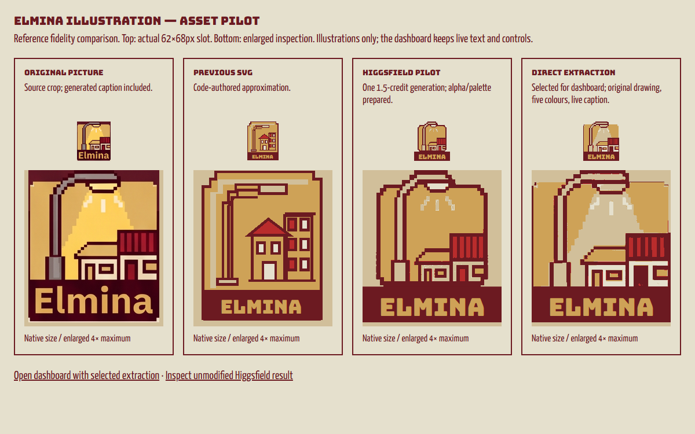
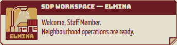

# Elmina illustration — Higgsfield/reference-extraction pilot

22 October 2026. The user approved trying the proposed reference-first asset workflow after rejecting approximate dashboard artwork. Scope is one decorative Elmina illustration, one initial Higgsfield generation, and comparison inside the existing dashboard. No other motifs or control artwork were generated.

## Result

The sandbox and shared SDP specimen now use the **direct extraction of the original illustration**, normalized to the five approved colours, with `Elmina` rendered as live SVG text in Bungee. The image contains illustration only: no caption, button, card, control or surrounding dashboard text.

The Higgsfield candidate was generated and inspected. Its lamp/building arrangement is closer to the reference than the earlier code-authored drawing, but it changes the illustration's proportions, light cone, lamp base and roof details. The original extraction preserves those drawing details more faithfully. A second generation was not needed for this comparison and was not submitted.

- [Live dashboard](http://127.0.0.1:5177/sdp-workspace.html#sdp).
- [Four-way comparison](http://127.0.0.1:5177/art/sdp-asset-pilot/pilot-review.html): original crop, previous SVG, prepared Higgsfield candidate and selected direct extraction, each at the 62×68px badge size and enlarged for inspection.
- Selected file: `public/assets/dashboard/sdp/elmina-extracted-v1.png`, **228×192 RGBA**, 2,498 bytes; SVG positions it above the live caption without stretching the artwork.
- SHA256: `9548a76d060fcdd62e0dfc572fdb09fe84a300afab2afb7a18893b69656ef576`.

## Generation and provenance

The image tools were inspected for reference-image roles, transparency parameters and cost. The selected model was `gpt_image_2_5`, Flare variant, high quality, 1K, portrait 3:4, transparent background, count one. Preflight quoted **1.5 credits**; that price was stated before submission. The returned model matches the requested model.

- Original dashboard: generation `cf2f2407-8d7f-41b3-9622-052b49ec2ba0`; original provenance remains in `art/sdp-dashboard-explorations/dispatch-desk-revision-01.json`.
- Focused crop uploaded and confirmed as `ba6ccd0c-6c4d-471f-8a37-f3ced1a55909`.
- Pilot job: `bb52a221-f966-4a39-9668-d509848adfa5`, confirmed **completed** through `jobs_wait`.
- The prompt, exact parameters, quote, returned media references and result URL are preserved in `art/sdp-asset-pilot/generation-record.json`. The unmodified result is `elmina-higgsfield-v1.png`.

The result is **880×1168 RGBA**, with alpha range 0–254 and a soft peripheral glow. Comparison preparation thresholds alpha at 128, crops transparent margins, and applies the same palette policy as the extraction. It preserves aspect ratio; it does not stretch the generated drawing into the reference proportions. Prepared candidate dimensions are **767×802**. The source extraction's illustration body is **228×192**, explaining part of the visible difference.

The extraction uses the full-resolution 1536×2752 selected image, a context crop `[115,225,390,555]`, and an explicit illustration-only polygon. The bottom raster caption is excluded. `prepare-extraction.py` records the exact crop/polygon and asserts alpha, dimensions and palette. Neutral metal and the bright light cone map to sand to retain contrast against gold; other pixels map to the nearest approved colour. Both candidates use this same policy. This removes generated shading and therefore does not claim a byte-identical copy of the original artwork's colours.

Source and processing are appended to `art/ASSET_LEDGER.csv`. Files are retained locally for the prototype; no separate redistribution licence is asserted. No additional project, new dependency, deployment or main-app dashboard rollout was created.

## Integration and verification

`SdpMotif` retains its decorative SVG root, `aria-hidden="true"`, `focusable="false"` and pointer transparency. Only its Elmina branch uses an SVG `<image>` plus live caption. Other motifs remain code-authored. Pixelated rendering preserves hard edges when downscaled. The unused Elmina-only lamp branch was removed; the streetlight motif retains its previous drawing.

- Browser integration test first failed because the original SVG contained no `<image>`, then passed after integration.
- `npx playwright test --config tmp/sdp.phase2.config.js tests/e2e/sdp-dashboard.spec.js tests/e2e/sdp-components.spec.js --reporter=list`: **21 passed**, including the new asset/caption test, reference geometry, four required viewport widths, normal/200% text, native interactions, store isolation and shared-context regression checks.
- `python art/sdp-asset-pilot/prepare-extraction.py`: dimensions, actual transparency, exact five-colour pixels, and lamp metal contrast assertions **passed**.
- Targeted ESLint on `SdpMotif.jsx` and the touched dashboard test: **passed**.
- Main build and targeted `sdp-workspace.html` build: **passed**. Targeted build retains the earlier >500KB chunk warning.
- Production preview is checked for dashboard navigation, direct refresh, development-specimen exclusion and no page errors; the built PNG is compared with the selected source hash.
- `graphify update .` refreshes the local AST graph after the integration.

Logs are in `artifacts/sdp-dashboard/elmina-pilot/`; comparison HTML/images, original/source crops, candidates, extraction metadata and generation record are in `art/sdp-asset-pilot/`. Physical-device validation and approval of additional illustration pilots are outside this single-asset result.
